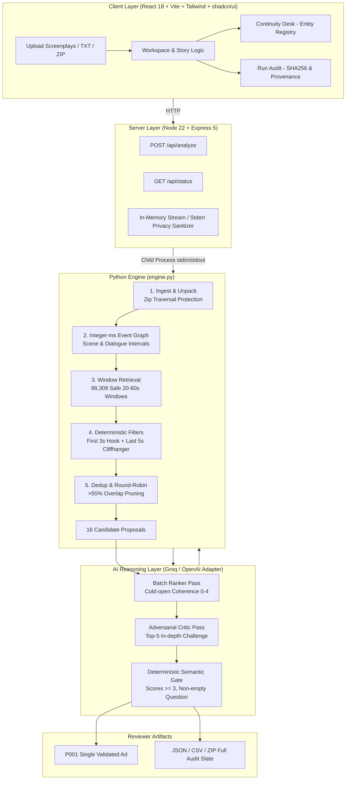

<div align="center">

# 🎬 PromoProof
### *Source-Grounded, Continuity-Aware Promo Discovery for Microdramas*

**AI Generalist Assignment — Problem 1: Find the Promos (Ads)**  
**Target Organization:** Kuku Technologies (Kuku FM / Kuku TV)  
**Candidate:** [Dipanshu Raj](https://github.com/Dipanshur19) (IIT Kanpur)

[](https://github.com/Dipanshur19/promoproof/actions/workflows/ci.yml)
[](tests/)
[](tsconfig.json)
[](Dockerfile)
[](https://promoproof-bvhz.onrender.com/#/)
[-orange)](#-privacy--zero-data-retention)
[](package.json)

[🌐 **Live Web Application**](https://promoproof-bvhz.onrender.com/#/) • [📄 **Two-Page Solution Document**](DEPLOYMENT.md) • [📊 **Reviewer Output Suite**](#-measured-full-pack-benchmark) • [⚡ **Quickstart**](#-quickstart--run-locally)

</div>

---

## 📌 Executive Summary

Acquisition editors at **Kuku Technologies** currently watch dozens of microdrama episodes each week by hand to select 20–60 second ad clips for paid acquisition campaigns across TikTok, Instagram Reels, and YouTube Shorts.

**PromoProof** automates this workflow with a core engineering principle:  
> **"Deterministic correctness before creative taste."**  
> *Code strictly owns the integer-millisecond timestamps, legal cut boundaries, and deduplication — guaranteeing the LLM cannot hallucinate cut points or interrupt actors mid-sentence. The model only evaluates cold-open comprehension, hook punch, and unresolved dramatic tension.*

---

## 🌟 Key Features & Innovations

- ⏱️ **Zero Mid-Dialogue Cuts:** Boundaries are mechanically verified against all spoken lines. A cut inside any dialogue block ($\text{start} < t < \text{end}$) is strictly rejected.
- 🧮 **Integer-Millisecond Arithmetic:** Timecodes are parsed into exact milliseconds ($t \in \mathbb{N}$), preventing IEEE 754 binary floating-point roundoff errors.
- ⚡ **86.74% Token Optimization:** Evaluates 98,309 legal candidate windows across 50 episodes, pruning them to the top 16 candidates *before* LLM invocation ($169\text{k} \to 22.4\text{k}$ input tokens).
- 💰 **Sub-Cent Economics:** Full-season 50-episode discovery and adversarial critique runs for **$0.0099** (< 1¢) on Groq LPUs.
- 🔍 **The P016 Validator Bug Discovery:** Detected an edge case where an LLM passed a composite cut with poor stitch legibility and no open question. Tightened deterministic code gates to reject it without paying for new inference.
- 🛡️ **Zero Data Retention (ZDR):** Script excerpts are processed strictly in-memory and routed through Groq enterprise endpoints with zero data retention.
- 🎭 **Continuity Desk:** Detects entity drift (e.g., `THE BEARDED STRANGER` $\to$ `ALEXANDER`) and treats generic names (`BLOND NOBLEMAN`) as episode-scoped to prevent disastrous cross-episode edit collisions.

---

## 🏗️ System Architecture



---

## 📊 Measured Full-Pack Benchmark (50 Episodes)

From the unedited reviewer run on Kuku's 50-episode season (*"I Married a Broken Soldier"*):

| Metric | Measured Value | Notes |
|---|---|---|
| **Episodes Ingested** | **50 / 50** | 100% block coverage (3,727 / 3,727 events) |
| **Legal Windows Scanned** | **98,309** | All combinations satisfying $20\text{s} \le \Delta t \le 60\text{s}$ |
| **Shortlisted Proposals** | **16** | 12 continuous cuts + 4 same-episode composites |
| **Mechanical Validity** | **16 / 16 (100%)** | Zero dialogue overlap violations |
| **Raw Pack Tokens** | **169,143** | $o200k\_base$ tokenizer |
| **Model Input Tokens** | **37,365** | Across 11 API requests (8 ranker + 3 critic) |
| **Token Reduction** | **86.74%** | Achieved via deterministic candidate prefiltering |
| **Inference Cost** | **$0.00993** | **Under 1 cent** on Groq listed rates |
| **Semantic Gate Passes** | **1 (P001)** | Episode 20 (53.7s, Catherine teacup hook vs valley fever) |
| **Unit Test Suite** | **46 / 46 Passing** | 36 engine + 10 deployment safety tests |

---

## 🎬 Top Pick Breakdown: Proposal P001

* **Source:** Episode 20 (`00:15.400` – `01:09.100`)
* **Duration:** 53.700 seconds (Continuous)
* **First 3s Hook:** Medium close-up of Catherine raising the porcelain teacup to her lips, her expression turning sharp and dismissive (`#e020b002`).
* **Closing Cliffhanger:** *"If I stop, Seamus, the lung fever in the valley wins."* (`#e020b018`).
* **Open Dramatic Question:** *Will Juliana's resolve stop the valley's lung fever?*
* **Audience Priority:** Broad Cold Traffic (#1).
* **Critic Note:** While mechanically and semantically sound, human creative review is still mandatory—a subtle porcelain teacup gesture may lack the initial velocity required for fast-scrolling TikTok feeds.

---

## ⚡ Quickstart — Run Locally

### Prerequisites
- **Node.js** 20.19+ (Node 22 recommended)
- **Python** 3.11+
- **Git**

```bash
# 1. Clone the repository
git clone https://github.com/Dipanshur19/promoproof.git
cd promoproof

# 2. Install Node dependencies
npm ci

# 3. Set up Python virtual environment
python -m venv .venv
# On Windows: .venv\Scripts\Activate.ps1
# On Linux/macOS: source .venv/bin/activate
pip install -r requirements-lock.txt

# 4. Run full test suite & type checks
python -m unittest discover -s tests -v
npm run check

# 5. Build and launch
npm run build
npm start
```
Open **`http://localhost:5000`** in your browser. Click **Run Demo** for an instant 2-second rules-only run on synthetic screenplays!

---

## 🐳 Docker Deployment

The application is containerized with a production multi-stage build running on port `7860`:

```bash
# Build the Docker image
docker build -t promoproof:local .

# Run container loopback-bound
docker run -d --name promoproof -p 127.0.0.1:7860:7860 promoproof:local

# Run production HTTP smoke test against the container
python scripts/smoke.py --url http://127.0.0.1:7860

# Clean up
docker rm -f promoproof
```

---

## 🔄 Live Model Swap (Interviewer Guide)

PromoProof features a modular provider adapter (`model_call`). During an interview or review:

### Via the Web UI (Zero Server Restarts)
1. In the top navigation bar, click the **Settings (gear icon)**.
2. Select your provider (**Groq** or **OpenAI-Compatible**).
3. Paste the API key and specify any supported model ID (`gpt-4o`, `openai/gpt-oss-120b`, `claude-3-5-sonnet-proxy`, etc.).
4. Click **Save Settings**. The parser and boundary logic remain identical.

### Via Environment Variables
```env
PORT=5000
GROQ_API_KEY=gsk_...
OPENAI_API_KEY=sk-...
OPENAI_BASE_URL=https://api.openai.com/v1
PROMOPROOF_MODEL=openai/gpt-oss-120b
```

---

## 🛡️ Privacy & Zero Data Retention

- **In-Memory Streaming:** Uploaded TXT/ZIP screenplay packs are ingested and parsed strictly in volatile memory. No script files are ever written to disk or local databases.
- **Sanitized Logging:** All HTTP request and response bodies are omitted from server access logs to prevent accidental exposure of unreleased IP.
- **Provider Confidentiality:** Groq enterprise APIs enforce strict Zero Data Retention (ZDR), ensuring confidential show scripts are never used for model training.

---

## 📂 Repository Structure

```
promoproof/
├── engine.py                  # Core Python screenplay analysis engine (441 lines)
├── Dockerfile                 # Multi-stage production container configuration
├── package.json               # Node 22 + Express + React 18 dependencies
├── requirements-lock.txt      # Pinned Python dependencies (openai, pydantic)
├── DEPLOYMENT.md              # Complete deployment and interview runbook
│
├── client/                    # Frontend React SPA
│   ├── index.html
│   └── src/
│       ├── App.tsx            # Main single-page application & state machine
│       ├── demo.ts            # Synthetic microdrama episode generator
│       └── components/ui/     # Radix UI + shadcn/ui components
│
├── server/                    # Backend API Server
│   ├── index.ts               # Express bootstrap with cross-platform socket handling
│   ├── routes.ts              # API routes (/api/status, /api/analyze)
│   └── static.ts              # Production static file serving
│
├── scripts/                   # Verification & Deployment Tooling
│   ├── smoke.py               # Automated end-to-end HTTP smoke test
│   ├── release_bundle.py      # Secret scanner & bundle whitelist validator
│   └── push_space.py          # Hugging Face Spaces safe uploader
│
└── tests/                     # Automated Test Suite (46 tests)
    ├── test_engine.py         # 36 core engine, timing, and gate tests
    └── test_deployment.py     # 10 security, credential, and release tests
```

---

## 👨‍💻 Author

**Dipanshu Raj**  
Indian Institute of Technology Kanpur (IIT Kanpur)  
- **GitHub:** [@Dipanshur19](https://github.com/Dipanshur19)  
- **Submission:** Kuku Technologies Placement Interview Shortlist (AI Generalist)

---

<div align="center">
<sub>Built with precision, integrity, and respect for confidential creative IP.</sub>
</div>
