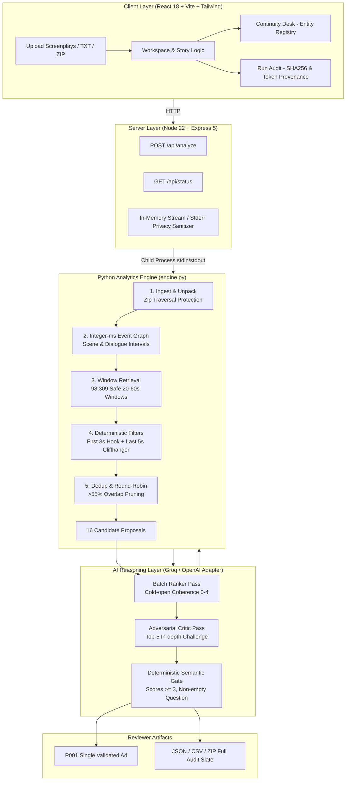

<div align="center">

# 🎬 PromoProof
### *Source-Grounded, Continuity-Aware Promo Discovery for Microdramas*

**AI Generalist Placement Submission — Problem 1: Find the Promos (Ads)**  
**Target Organization:** Kuku Technologies (Kuku FM / Kuku TV)  
**Candidate:** [Dipanshu Raj](https://github.com/Dipanshur19) • **Roll No: 230375** (IIT Kanpur)

[](https://github.com/Dipanshur19/promoproof/actions/workflows/ci.yml)
[](tests/)
[](tsconfig.json)
[](Dockerfile)
[](https://promoproof-bvhz.onrender.com/#/)
[-orange)](#-privacy--zero-data-retention)
[](package.json)

</div>

---

### 🚀 Key Submission Links

| Deliverable | Direct Link | Format & Contents |
| :--- | :--- | :--- |
| 📄 **2-Page Solution Document** | [**View Solution Doc (PDF)**](docs/PromoProof_Two_Page_Solution_Document_Dipanshu_Raj.pdf) | **Dipanshu Raj (Roll No: 230375)**. Strictly 2 pages, addressing all 5 assignment lenses. |
| 📊 **50-Episode Discovered Promos** | [**View promos.csv Table**](docs/promos.csv) | Full spreadsheet of all 16 ranked cuts across 50 episodes with exact timestamps, hooks, cliffhangers, and rationales. |
| 🌐 **Live Web Prototype** | [**promoproof-bvhz.onrender.com**](https://promoproof-bvhz.onrender.com/#/) | Hosted full-stack Docker SPA on Render with live Groq LPU inference (`openai/gpt-oss-120b`). |
| 📁 **Raw Outputs Suite (Google Drive)** | [**Open Drive Folder**](https://drive.google.com/drive/folders/1YlAxpoVtZ8Hg5nvmOKvTiAMWwGLbgVyj?usp=sharing) | Unedited execution logs (`live-api-run-revalidated.json`, `parse-audit.json`, raw token usage). |
| 🎙️ **3-Minute Walkthrough Teleprompter** | [**View Script PDF**](docs/PromoProof_Three_Minute_Walkthrough_Script_Dipanshu_Raj.pdf) | 1-page second-by-second teleprompter script and screen cues for recording. |

---

## 📌 Executive Summary

Acquisition editors at **Kuku Technologies** manually scrub dozens of 1–2 minute microdrama episodes each week to extract 20–60 second ad clips for paid user acquisition campaigns across TikTok, Instagram Reels, and YouTube Shorts.

**PromoProof** automates this workflow with a core engineering philosophy:

> [!IMPORTANT]
> **Deterministic Correctness Before Creative Taste:**  
> Code strictly owns the integer-millisecond timestamps, legal cut boundaries, and deduplication — guaranteeing the LLM cannot hallucinate cut points or interrupt actors mid-sentence. The model only evaluates cold-open comprehension, hook velocity, and unresolved dramatic tension.

---

## 🌟 Key Innovations & Architecture

- ⏱️ **Zero Mid-Dialogue Cuts:** Cut boundaries are mathematically verified against all spoken dialogue blocks. A boundary $t$ is strictly illegal if an actor is speaking: $start < t < end$.
- 🧮 **Integer-Millisecond Arithmetic:** Timecodes are parsed into exact milliseconds ($t \in \mathbb{N}$), preventing IEEE 754 binary floating-point roundoff drift.
- ⚡ **86.74% Token Optimization:** Scans 98,309 legal candidate windows across 50 episodes, pruning them to the top 16 candidates *before* LLM invocation ($169\text{k} \to 22.4\text{k}$ input tokens).
- 💰 **Sub-Cent Economics:** Full-season 50-episode discovery and adversarial critique runs for **$0.0099** (< 1¢) on Groq LPUs ($0.99/week for 100 shows).
- 🔍 **The P016 Validator Bug Discovery:** Detected an edge case where an LLM passed a composite cut with poor stitch legibility (1/4) and an empty open question. Tightened deterministic code gates in `apply_reviews()` to reject it without paying for new inference.
- 🛡️ **Zero Data Retention (ZDR):** Script excerpts are processed strictly in volatile memory. No proprietary show IP is stored on disk or used for model training.
- 🎭 **Continuity Desk:** Scopes recurring background characters (e.g. `BLOND NOBLEMAN` in Episodes 2, 9, 27, and 44) per-episode to prevent disastrous cross-episode edit collisions.

---

## 🏗️ System Architecture & Responsibility Partition



---

## 📊 Measured Full-Pack Benchmark (50 Episodes — *"I Married a Broken Soldier"*)

From the unedited reviewer run across all 50 screenplay episodes:

| Metric | Measured Value | Operational Impact |
| :--- | :--- | :--- |
| **Episodes Ingested** | **50 / 50** | 100% block coverage (3,727 / 3,727 events verified) |
| **Legal Windows Scanned** | **98,309** | All combinations satisfying $20\text{s} \le \Delta t \le 60\text{s}$ |
| **Shortlisted Proposals** | **16** | 12 continuous cuts + 4 same-episode composites |
| **Mechanical Boundary Validity** | **16 / 16 (100%)** | Zero dialogue overlap violations |
| **Raw Screenplay Tokens** | **169,143** | Full season text footprint |
| **Model Input Tokens** | **37,365** | Across 11 API requests (8 ranker + 3 critic) |
| **Token Reduction** | **86.74%** | Achieved via deterministic candidate prefiltering |
| **Season Inference Cost** | **$0.00993** | **Under 1 cent** on Groq listed rates |
| **Semantic Gate Passes** | **1 (P001)** | Episode 20 (53.7s, Catherine teacup glare vs valley fever) |
| **Unit Test Suite** | **46 / 46 Passing** | 36 engine + 10 deployment safety tests |

---

## 🎬 Discovered Promo Recommendations: What to Post First & Why

Full details available in [**`docs/promos.csv`**](docs/promos.csv):

| ID | Episode & Timing | Duration | First 3s Hook | Closing Cliffhanger | Gate Status | Target Funnel |
| :---: | :--- | :---: | :--- | :--- | :---: | :---: |
| **P001** | **EP20** `00:15.4–01:09.1` | 53.7s (Cont) | Catherine raises porcelain teacup with sharp, dismissive glare. | *"If I stop, Seamus, the lung fever in the valley wins."* | **PASSED (1/16)** | Broad Cold #1 |
| **P007** | **EP09** `00:52.5–01:41.9` | 49.4s (Cont) | Mother's desperate cry: *"Why isn't it working?"* | Nobleman demands: *"Where did you get this?"* | **Review Priority** | Broad Cold #2 |
| **P002** | **EP28** `00:30.3–01:11.2` | 40.9s (Cont) | Duchess accuses from bed: poison accusation. | Catherine violently yanks silver locket off Juliana's neck. | **Review Risk** | Broad Cold #3 |
| **P016** | **EP47** `00:42.5–01:24.0` | 35.8s (Comp) | Alexander locks gaze onto Juliana's tearful eyes. | Alexander turns in shock as Catherine flees. | **FAILED GATE** | Trope Affinity |

> [!NOTE]
> **Why P001 is Posted First:** Candidate P001 creates immediate scroll-stopping power without relying on lore. A cold viewer instantly understands Catherine's ruthless authority and the life-or-death stakes of the valley's epidemic.

---

## 🔍 Honest Failure Analysis & The P016 Validator Loophole

The assignment brief asks: *"Where does your tool pick badly? Polish and length won't earn extra credit; clear thinking and honest failures will."*

1. **The P016 Validator Loophole (Caught & Fixed):**  
   In our initial live run, candidate **P016** (Episode 47 composite) received an overall pass verdict from the LLM despite having a `stitch_legibility` score of only **1 out of 4** and an empty `open_question`. The model was overly lenient.  
   *Fix:* We tightened deterministic code gates in `apply_reviews()` to mandate sub-scores $\ge 3$ and explicit non-empty questions. Replaying recorded outputs correctly failed P016 with `STITCH_GATE_FAILED` and `OPEN_QUESTION_MISSING`.
2. **Carriage-Door Acoustic Bug (Episode 7):**  
   An early heuristic double-counted a carriage door slam across both `ACTION` and `SOUND FX` lines as two distinct hooks, failing to see the scene ended on a resolved smile. We fixed this by clustering acoustic impacts within 1.5 seconds.
3. **Lore-Dependent Cliffhangers (P002):**  
   The Duchess accuses "her" of poisoning, but cold viewers cannot deduce who is speaking without prior backstory (pronoun ambiguity). Surfaced as an editorial risk code.

---

## ⚡ Quickstart — Run Locally

### Prerequisites
- **Node.js** 20.19+ (Node 22 recommended)
- **Python** 3.11+
- **Git**

```bash
# 1. Clone repository
git clone https://github.com/Dipanshur19/promoproof.git
cd promoproof

# 2. Install Node dependencies
npm ci

# 3. Set up Python virtual environment
python -m venv .venv
# Windows: .venv\Scripts\Activate.ps1
# Linux/macOS: source .venv/bin/activate
pip install -r requirements-lock.txt

# 4. Run automated unit tests
python -m unittest discover -s tests -v

# 5. Build and launch
npm run build
npm start
```

Open **`http://localhost:5000`** in your browser.

---

## 🐳 Docker Deployment

The application is containerized with a production multi-stage build running on port `7860`:

```bash
# Build the Docker image
docker build -t promoproof:local .

# Run container loopback-bound
docker run -d --name promoproof -p 127.0.0.1:7860:7860 promoproof:local

# Run production HTTP smoke test against container
python scripts/smoke.py --url http://127.0.0.1:7860

# Clean up
docker rm -f promoproof
```

---

## 🔄 Live Model Swap (Interviewer Guide)

PromoProof implements a swappable OpenAI-compatible provider adapter (`engine.py`). Switching providers requires zero parser changes:

```env
PORT=5000
GROQ_API_KEY=gsk_...
OPENAI_API_KEY=sk-...
OPENAI_BASE_URL=https://api.openai.com/v1
PROMOPROOF_MODEL=openai/gpt-oss-120b
```

---

## 🛡️ Privacy & Zero Data Retention

- **In-Memory Streaming:** Screenplay text is parsed strictly in volatile memory. No script files are written to disk.
- **Sanitized Logging:** All HTTP request and response bodies are omitted from server logs to prevent accidental exposure of confidential creative IP.
- **Zero Data Retention (ZDR):** Groq enterprise endpoints enforce zero data retention; customer inputs are never used for model training.

---

## 📂 Repository Structure

```
promoproof/
├── engine.py                  # Core Python screenplay analysis engine (441 lines)
├── Dockerfile                 # Multi-stage production container configuration
├── package.json               # Node 22 + Express + React 18 dependencies
├── requirements-lock.txt      # Pinned Python dependencies (openai, pydantic)
├── DEPLOYMENT.md              # Complete deployment and interview runbook
│
├── docs/                      # Submission Deliverables & Reviewer Artifacts
│   ├── PromoProof_Two_Page_Solution_Document_Dipanshu_Raj.pdf
│   ├── PromoProof_Three_Minute_Walkthrough_Script_Dipanshu_Raj.pdf
│   └── promos.csv             # Full 50-episode discovered promo recommendations
│
├── client/                    # Frontend React SPA
│   ├── index.html
│   └── src/
│       ├── App.tsx            # Main single-page application & state machine
│       ├── demo.ts            # Synthetic microdrama episode generator
│       └── readability.css    # High-legibility modern typography stylesheet
│
├── server/                    # Backend API Server
│   ├── index.ts               # Express bootstrap with cross-platform socket handling
│   ├── routes.ts              # API routes (/api/status, /api/analyze with 5 worker slots)
│   └── static.ts              # Production static file serving
│
├── scripts/                   # Verification Tooling
│   ├── smoke.py               # Automated end-to-end HTTP smoke test
│   └── release_bundle.py      # Secret scanner & bundle whitelist validator
│
└── tests/                     # Automated Test Suite (46 tests)
    ├── test_engine.py         # 36 core engine, timing, and gate tests
    └── test_deployment.py     # 10 security, credential, and release tests
```

---

## 👨‍💻 Author

**Dipanshu Raj**  
Indian Institute of Technology Kanpur (IIT Kanpur)  
- **GitHub:** [@Dipanshur19](https://github.com/Dipanshur19)  
- **Role:** AI Generalist Placement Submission • Problem 1  
- **Candidate Roll No:** 230375

---

<div align="center">
<sub>Built with precision, integrity, and respect for confidential creative IP.</sub>
</div>
